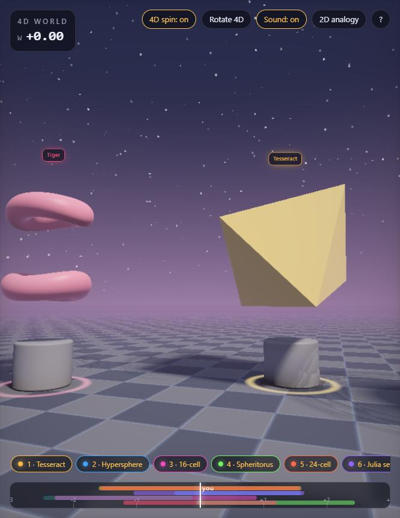
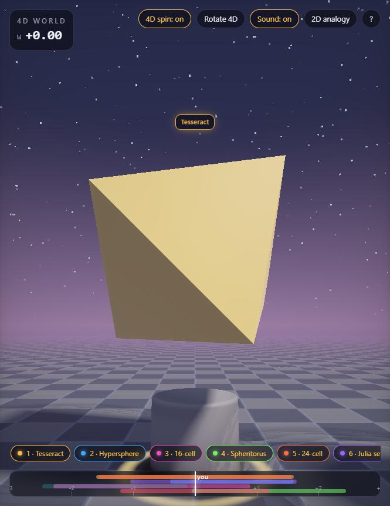
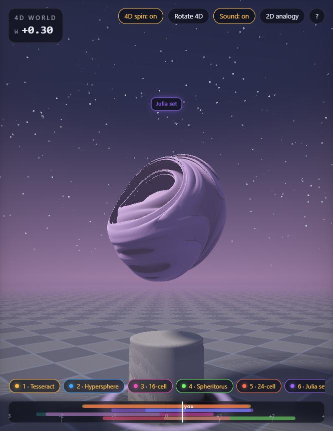

# 4D World

Walk through a four-dimensional space and watch the 3D slices of shapes our brains
cannot picture. You are a 3D being; your eyes only ever see one 3D slice of the 4D
world. Move along the fourth axis, **W**, and solid shapes swell out of nothing,
change form, and vanish.

**▶ Run it in your browser: [daviddavoyan.github.io/4d-world](https://daviddavoyan.github.io/4d-world/)**

One HTML file. No images, no libraries, no build step. Every pixel is a ray marched
through real four-dimensional signed distance fields, live on your GPU (WebGL 2).



## What is in the gallery

Eight true 4D objects stand on pedestals. Each one is a 4D signed distance field; the
scene you see is that field cut by the hyperplane *w = your W*.

| # | Shape | What its slices do |
|---|-------|--------------------|
| 1 | **Tesseract** (4D cube) | spins in the plane of W and its space diagonal: cube → truncated cube → regular **octahedron** at 60° → **hexagonal prism** at 90° → back |
| 2 | **Hypersphere** (4D ball) | a sphere whose radius follows √(R² − w²): it grows from a point and shrinks back |
| 3 | **16-cell** (4D octahedron) | octahedra and their truncations |
| 4 | **Spheritorus** (a 4D donut) | a hollow ball one moment, a torus the next |
| 5 | **24-cell** | the regular polytope with no 3D cousin; its central slice is a rhombic dodecahedron |
| 6 | **Quaternion Julia set** | a 4D fractal (Douady's rabbit lifted to the quaternions) |
| 7 | **Torisphere** | a torus that fattens and thins |
| 8 | **Tiger** | two donuts that merge into one and vanish |




Other things to notice:

- The floor is a 3D plane inside the 4D space, so its pattern breathes as you move in W.
- A pedestal's ring lights up when its shape is in your slice; a dim label means the
  shape exists, but not where you are. Press its number to travel there, with a trip in W.
- **Rotate 4D** turns every shape in the XW, YW and ZW planes. A 4D rotation changes the
  *shape* of a slice, not just its angle.
- **2D analogy** shows the same idea one dimension down: a cube crossing Flatland, and the
  polygon a 2D being would see.
- A quiet drone follows W, and a chime marks a shape entering or leaving your slice.

## Controls

| | |
|---|---|
| click | enter, the mouse looks around |
| W A S D | walk |
| Q / E, or the scroll wheel | move in W |
| Space / Shift | float up / down |
| 1 – 8 | teleport to a shape |
| R | pause the 4D spin |
| M | sound on / off |

On a phone: drag to look, the joystick walks, the bottom bar is W, and the chips travel.

## The math check

When the page loads it checks three facts against the same formulas the shader uses,
and prints the result in the intro:

1. a hypersphere of radius 1 sliced at w = 0.6 is a sphere of radius 0.8 (3-4-5);
2. a tesseract turned so its long diagonal points along W has, as its central slice, a
   regular octahedron whose six vertices are the permutations of (1, 1, −1, −1);
3. the tiger at w = 0 is two separate tori, and at w = 0.5 they have merged.

## Running it locally

```bash
npx -y serve -l 5209 .
```

Any static server works, and so does opening `index.html` directly (except that
pointer lock needs a real origin, so the mouse look falls back to click-and-drag).

## License

MIT, see `LICENSE`.
